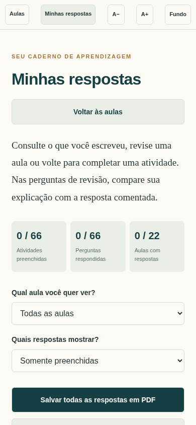

# Academia de Jiu-Jitsu faturando mais — 22 aulas ilustradas

Guia de aplicação com **115 páginas**, organizado em 6 módulos, com objetivos, exemplos resolvidos, atividades e revisão.

- [Baixar o PDF ilustrado](https://github.com/contatodouglasempreender-design/CRIPTO/raw/refs/heads/main/ebook/aulas/guia-aulas-ilustradas.pdf)
- [Baixar o pacote completo](https://github.com/contatodouglasempreender-design/CRIPTO/raw/refs/heads/main/ebook/aulas/pacote-aulas-ilustradas.zip)
- [Baixar o HTML interativo](https://github.com/contatodouglasempreender-design/CRIPTO/raw/refs/heads/main/ebook/aulas/guia-interativo-respostas.html)

O pacote inclui o guia em PDF, o HTML interativo, o livro completo de consulta e um arquivo de instruções.

## Como estudar

Cada aula segue a sequência: entender a ideia, visualizar o mapa e o exemplo, executar os passos, preencher a ficha e responder à revisão. As respostas comentadas estão no final do PDF e podem ser abertas dentro de cada aula no HTML.

São 8 ilustrações temáticas, 22 mapas visuais, 66 atividades, 66 perguntas de revisão e 11 modelos para copiar ou imprimir.

## Minhas respostas

1. Baixe o HTML interativo e abra-o no navegador.
2. Escolha uma aula e preencha as atividades e as perguntas de revisão.
3. Clique em **Minhas respostas** para ver seu caderno por aula.
4. Use **Editar minha resposta** para voltar ao campo correspondente.
5. Use **Salvar todas as respostas em PDF** para abrir a impressão e selecionar Salvar como PDF.

O painel também permite mostrar pendências, comparar suas explicações com as respostas comentadas e baixar uma cópia independente para leitura. As perguntas abertas não recebem nota automática.

As respostas são salvas neste navegador quando o armazenamento está disponível. Use **Guardar cópia para continuar depois** para fazer um backup e **Restaurar uma cópia** para recuperar as respostas em outro navegador ou aparelho.

As imagens estão incorporadas; o HTML funciona sem conexão depois de baixado. O conteúdo extenso dos 22 capítulos continua no aprofundamento de cada aula. O PDF estático de 115 páginas e o livro de consulta acompanham o pacote.

## Prévia da capa

